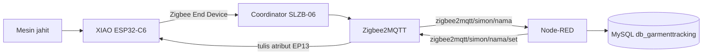
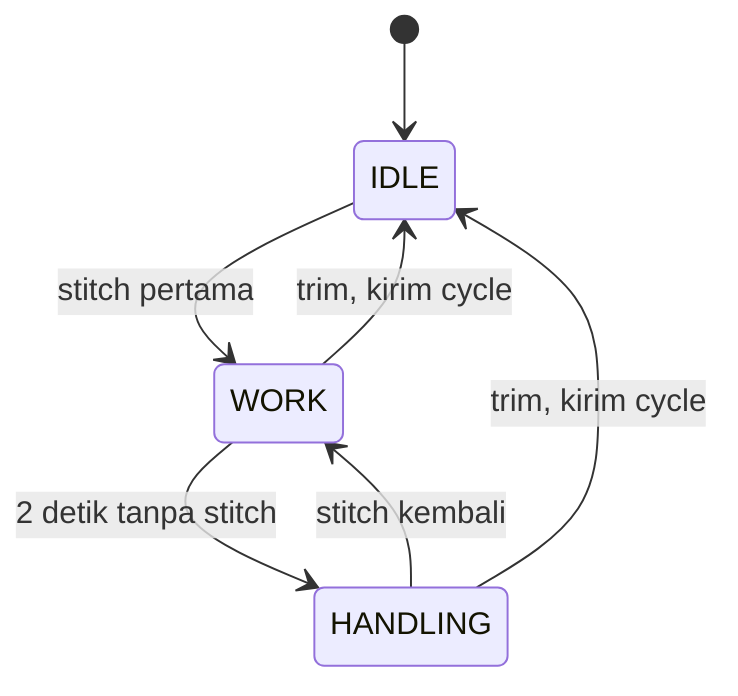

# SIMON — XIAO ESP32-C6

SIMON memantau produksi mesin jahit. Perangkat di mesin menghitung stitch serta waktu work, idle, dan handling, lalu satu cycle dikirim lewat Zigbee setiap trim. Zigbee2MQTT menerjemahkan pesan itu, Node-RED mencocokkan operator, dan MySQL menyimpan hasilnya.

Repositori ini berisi firmware `SIMON-8.4.0-XIAO-EXT-ANT-C6` di [`src/main.ino`](src/main.ino). Converter Zigbee2MQTT dan flow Node-RED berjalan di server garment tracking. Label versinya berbeda (converter tertulis V8.3, flow tertulis V8.2), tetapi kontrak pesannya sama dengan firmware ini.

## Arsitektur



| Lapisan | Peran |
|---|---|
| XIAO ESP32-C6 | Sensor, RFID, LCD, buzzer, dan Zigbee End Device. Sesi operator serta status join disimpan di NVS. |
| SLZB-06 | Coordinator Zigbee. Firmware mengirim langsung ke short address `0x0000`, endpoint 1. |
| Zigbee2MQTT | External converter cluster `0xFC10` plus Analog Input pada endpoint 10, 11, 12, dan 14. |
| Node-RED | Auth, insert produksi, boot, heartbeat, state mesin, dan deteksi offline. |
| MySQL `db_garmenttracking` | Operator, info mesin, cycle produksi, dan runtime. |

MQTT dan MySQL pada flow yang dipakai mengarah ke `10.5.0.107` (MQTT 1883, MySQL 3306). Nama perangkat di Zigbee2MQTT adalah segmen terakhir topik dan dipakai sebagai `id_device`.

Topik masuk: `zigbee2mqtt/simon/+`  
Topik jawaban auth: `zigbee2mqtt/simon/<perangkat>/set`

## Cara kerja

### Cycle produksi

Sensor di mesin menghasilkan stitch. Pulsa LOW 200 ms atau lebih adalah trim dan menutup cycle.

Firmware mengirim empat laporan Analog Input berurutan, dengan jeda singkat. Endpoint 12 selalu terakhir dan menjadi pemicu insert.

| Endpoint | Field MQTT | Arti |
|---|---|---|
| 10 | `analog_in_count_10` | Work, detik |
| 11 | `analog_in_count_11` | Idle, detik |
| 14 | `analog_in_count_14` | Handling, detik |
| 12 | `analog_in_count_12` | Total stitch, atau output pada sensor limit |

Converter menambahkan `production_event` (waktu terima, ms) dan `production_source` (nomor endpoint). Node-RED mengabaikan pesan yang lebih lama dari 5 detik atau yang `production_event` yang sama sudah diproses.

Nilai endpoint 10, 11, dan 14 disimpan di cache perangkat. Insert hanya terjadi saat endpoint 12 tiba, dan hanya jika work serta idle dari cycle yang sama masih berumur maksimal 2,5 detik. Handling dipakai bila baru diterima dalam jendela yang sama. Firmware limit lama yang tidak mengirim endpoint 14 dicatat sebagai handling 0. Cycle dengan work, idle, dan handling semuanya 0 tidak di-insert.

Baris masuk ke `spm_machine`. Identitas operator diambil dari sesi Node-RED. Jika operator baru logout, identitas sebelumnya masih dipakai paling lama 5 detik supaya cycle yang dikirim tepat sebelum logout tidak kehilangan nama.

`sensor_type` dibaca dari `spm_machineinfo` saat insert. Bila belum ada, dianggap photosensor.

| `sensor_type` | Endpoint 12 disimpan sebagai |
|---|---|
| 1, photosensor | `total_stitch`, `output` = 0 |
| 2, limit switch | `output`, `total_stitch` = 0 |

Produksi tetap dicatat meski tidak ada operator yang login. Kolom operator pada baris itu kosong.

### Login RFID

Pembaca RDM6300 mengirim nomor kartu. Firmware meminta auth ke cluster `0xFC10` dengan payload `aksi|RFID`. Aksi `1` adalah login atau ganti operator. Aksi `0` adalah logout karena kartu yang sama di-tap lagi.

Converter menerbitkan `auth_event`, `auth_action`, dan `rfid_user`. Node-RED hanya memproses event yang berumur maksimal 5 detik.

- Login mencari `rfid_user` di `spm_operator`. Baris terbaru yang punya NIK dianggap berhasil.
- Logout tidak mencari database. Status jawaban adalah `0`.
- Login yang gagal tidak menghapus operator yang sedang aktif di server.

Jawaban ditulis ke perangkat lewat MQTT `set`, berurutan, karena firmware baru menutup transaksi saat atribut status login tiba:

| Tunda | Atribut Zigbee | Field MQTT |
|---|---|---|
| langsung | NIK `0x0002` | `nik` |
| 100 ms | nama `0x0004` | `operator_name` |
| 200 ms | proses `0x0005` | `process_name` |
| 300 ms | cabang `0x0006` | `branch` |
| 450 ms | status `0x0003` | `login_status` |

Teks dipotong 64 karakter, sama dengan batas atribut di firmware. `login_status` `1` berarti login diterima. `0` berarti gagal atau logout. Firmware menunggu jawaban paling lama 10 detik.

Login yang diterima menyimpan sesi di `global.simonOperators` dan mengisi `spm_machineinfo`. Logout mengosongkan sesi di tabel itu, tetapi menyimpan salinan operator di `simonPreviousOperators` selama beberapa detik. Ganti operator yang ditolak tidak mengubah sesi lama, baik di server maupun di perangkat.

### Boot

Setelah Zigbee tersambung, firmware mengirim boot:

```text
versi|jenis_sensor|coordinator|state|login|rfid|nik|nama|proses|cabang
```

Contoh coordinator bawaan di firmware adalah `SLZB-06@10.5.2.100`. Itu teks identitas, bukan alamat radio.

Node-RED lalu:

1. Menutup baris `spm_runtime` yang masih terbuka dan mengisi durasinya.
2. Upsert `spm_machineinfo` (versi, jenis sensor, state, coordinator, dan sesi operator).
3. Membuka baris `spm_runtime` baru.
4. Jika perangkat masih menyimpan login, operator dicari ulang di `spm_operator` dan sesi server dipulihkan.

Boot juga menandai perangkat online di cache heartbeat.

### Heartbeat dan offline

Heartbeat dikirim setiap 10 detik:

```text
uptime_detik|state|login|rfid
```

Node-RED memperbarui `machine_state` di `spm_machineinfo` hanya bila state berubah atau perangkat baru kembali dari offline. Jika heartbeat membawa RFID yang belum ada di memori Node-RED, operator dipulihkan dari `spm_operator`. Heartbeat dengan login `0` mengosongkan sesi operator di `spm_machineinfo`.

Inject setiap 10 detik memeriksa cache heartbeat. Perangkat tanpa heartbeat selama 30 detik ditandai `machine_state = off`. Sesi operator di server dilepas. `spm_runtime` ditutup pada waktu heartbeat terakhir, karena perangkat yang sudah mati tidak bisa mengirim waktu mati sendiri. Saat heartbeat berikutnya datang, baris runtime baru dibuka.

### Perubahan state

Perpindahan idle, work, dan handling juga dikirim sebagai perintah terpisah, payload-nya hanya `idle`, `work`, atau `handling`. Node-RED menulis `spm_machineinfo.machine_state` dan menyelaraskan cache heartbeat. Transisi di mesin:



Dua detik tanpa stitch dihitung sebagai handling sejak stitch terakhir, bukan sebagai work. Setelah trim, cycle baru mulai dari idle. Logout mengirim cycle yang belum selesai lebih dulu, menunggu sekitar 300 ms, baru meminta logout.

Buzzer saat trim: 1 beep jika operator login, 2 beep jika belum.

## Kontrak Zigbee

Perangkat adalah Zigbee End Device, manufacturer `GGI Robotics`, model `SIMON`. Endpoint 13 adalah server cluster kustom `simonData` (`0xFC10`). Perintah perangkat ke coordinator memakai `commandsResponse` pada converter.

| ID | Perintah | Payload |
|---|---|---|
| `0x01` | `authRequest` | `aksi\|RFID` |
| `0x02` | `deviceBoot` | sepuluh kolom dipisah `\|`, lihat bagian Boot |
| `0x03` | `heartbeat` | `uptime\|state\|login\|rfid` |
| `0x04` | `machineState` | `idle`, `work`, atau `handling` |

Atribut yang ditulis Zigbee2MQTT ke endpoint 13: NIK, status login, nama operator, proses, dan cabang. Status login `uint8`. Yang lain `CHAR_STR`.

Laporan produksi adalah `genAnalogInput.presentValue`. Firmware mengirim report langsung, jadi data tetap sampai tanpa binding. `configure()` converter tetap men-bind endpoint 10, 11, 12, dan 14 ke coordinator supaya tabel binding Zigbee2MQTT lengkap setelah interview. Sumber daya perangkat dicatat sebagai `Mains (single phase)`.

## Perangkat keras

| Fungsi | Pin XIAO | GPIO | Catatan |
|---|---|---|---|
| Photo sensor NPN | D1 | GPIO1 | Active LOW |
| Active buzzer | D2 | GPIO2 | Nyala = HIGH |
| RDM6300 TX | D7 | GPIO17 | UART 9600 8N1, hanya RX |
| LCD SDA | D4 | GPIO22 | I2C, alamat `0x27`, 16x2 |
| LCD SCL | D5 | GPIO23 | I2C |
| RF switch enable | — | GPIO3 | LOW, antena eksternal |
| RF antenna select | — | GPIO14 | HIGH, konektor U.FL / I-PEX |

GPIO3 dan GPIO14 adalah sakelar RF onboard. Jangan memakainya untuk sensor lain selama antena eksternal aktif. Sakelar diatur sebelum stack Zigbee dimulai.

`SENSOR_TYPE` dikompilasi di firmware: `1` photosensor, `2` limit switch, `3` button. Nilai ini ikut payload boot dan menentukan cara Node-RED menyimpan endpoint 12.

Pulsa sensor active LOW:

| Lebar LOW | Arti |
|---|---|
| Di bawah 2 ms | Noise |
| 2–199 ms | Stitch |
| 200 ms atau lebih | Trim |

Setelah trim, pulsa LOW yang masih panjang tidak menjadi trim kedua. Sensor harus HIGH stabil sekitar 5 ms. Pulsa pendek berikutnya adalah stitch pertama cycle baru.

LCD berganti setiap 3 detik: operator dan proses, state serta waktu, stitch dan RFID, lalu status Zigbee dan NIK. Hasil trim ditahan sekitar 2,5 detik. Sebelum join, layar menampilkan `ZB JOINING...` atau `ERR PERMIT JOIN`. Saat rejoin, layar menampilkan `ZB REJOINING...`.

## Join Zigbee

Perangkat baru memindai kanal 11–26 dan butuh Permit Join. Join pertama menyimpan `zb_registered` di NVS. Boot berikutnya rejoin ke kanal 11 tanpa Permit Join. Jika NVRAM jaringan rusak, firmware menghapus flag itu lalu restart dan commissioning ulang.

Upload biasa tidak menghapus seluruh flash. Jangan memakai erase-all bila jaringan Zigbee dan sesi operator harus tetap ada.

## Database

Semua tabel ada di `db_garmenttracking`.

| Tabel | Dipakai untuk |
|---|---|
| `spm_operator` | Master RFID, NIK, nama, cabang, line, dan proses |
| `spm_machineinfo` | Perangkat: versi, jenis sensor, state, coordinator, dan operator aktif |
| `spm_machine` | Satu baris tiap cycle produksi |
| `spm_runtime` | Waktu hidup perangkat, dari boot atau reconnect sampai offline |

State `off` hanya ditulis server, saat heartbeat terputus. Firmware sendiri hanya mengirim `idle`, `work`, dan `handling`.

## Build firmware

Butuh [PlatformIO](https://platformio.org/) dengan platform `espressif32` 8.x (Arduino-ESP32 3.3.x).

```powershell
pio run
pio run -t upload
pio device monitor
```

Monitor serial memakai USB CDC bawaan XIAO pada 115200. Jika upload tidak mulai, tahan tombol BOOT saat esptool menulis.

Setara menu Arduino IDE: board XIAO ESP32C6, Zigbee Mode ED, partition Zigbee 4MB with spiffs, Erase All Flash disabled.

Di PlatformIO mode Zigbee ditulis `-D PIO_ARDUINO_ZIGBEE_MODE_ED`. Core lalu mendefinisikan `ZIGBEE_MODE_ED` dan menautkan library end device. Jangan menggantinya dengan `-D ZIGBEE_MODE_ED` saja: Arduino-ESP32 3.3.12 melewati penautan library Zigbee dan link gagal.

Partisi `zigbee.csv` menyediakan aplikasi sekitar 1,25 MB, SPIFFS, serta `zb_storage` dan `zb_fct`. Library luar hanya `marcoschwartz/LiquidCrystal_I2C` 1.1.4.

## Zigbee2MQTT dan Node-RED

Converter didaftarkan sebagai external converter. Fingerprint-nya `modelID: SIMON` dan `manufacturerName: GGI Robotics`, jadi perangkat ini tidak jatuh ke definisi Analog Input biasa.

Flow Node-RED `SIMON V8.2 - AUTH + WORK/IDLE/HANDLING` memakai satu node MQTT in. Lima fungsi berjalan paralel dari pesan yang sama: auth, insert produksi, boot, heartbeat, dan machine state. Pesan yang bukan miliknya dihentikan di fungsi itu. Node MySQL memakai database `db_garmenttracking`.

Cache Node-RED yang harus tetap hidup selama runtime:

| Context | Isi |
|---|---|
| `simonOperators` | Operator yang sedang login per perangkat |
| `simonPreviousOperators` | Operator yang baru logout, untuk cycle yang menyusul |
| `simonHeartbeat` | Waktu terakhir, status offline, dan state |
| `simonDeviceInfo` | Jenis sensor dan versi firmware |
